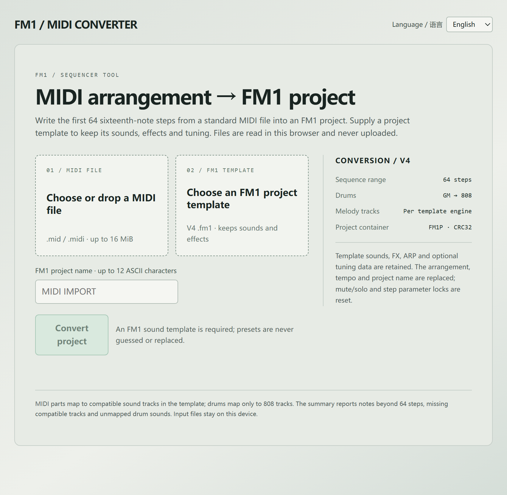

# FM1 MIDI Converter

A single-page, offline **MIDI → FM1 project** converter for the M-VAVE FM1
synthesizer. Drop a standard MIDI file and an FM1 V4 project template into the
page, press **Convert project**, and download a `.fm1` project that keeps the
template's sounds, effects and tuning.

Try it [here](https://balancechiang.github.io/fm1-midi-converter/).



## Features

- Reads a Standard MIDI File (format 0/1) and writes its first **64
  sixteenth-note steps** into an FM1 project.
- Maps General MIDI drum notes (35-81) onto the FM1 **808** kit.
- Writes melody and chord parts into compatible sound tracks of the supplied
  template; the template's engines decide which parts fit.
- Keeps the template's presets, FX, ARP and optional tuning data. The
  arrangement, tempo and project name are replaced; mute/solo and step
  parameter locks are reset.
- Reports notes beyond step 64, missing compatible tracks and unmapped drum
  notes in a conversion summary.
- English / 简体中文 UI, switchable in the page header (stored in
  `localStorage`).
- Fully client-side: files are read with the File API and never uploaded.

## Quick start

**Open it directly** — download `index.html` and double-click it. The page is
self-contained and works from `file://`.

**Serve it locally**

```sh
cd /path/to/fm1-midi-converter
python -m http.server 8000
# open http://localhost:8000/
```

**GitHub Pages** — push the repository, then *Settings → Pages → Build and
deployment → Deploy from a branch*, branch `main`, folder `/ (root)`. No build
step is needed: `index.html` at the repository root is the published page.

## How to use

1. **01 / MIDI FILE** — choose or drop a `.mid` / `.midi` file (up to 16 MiB).
2. **02 / FM1 TEMPLATE** — choose a **V4 `.fm1` project** to use as the sound
   template. The converter never guesses or replaces presets, so a template is
   required. No template is bundled with this project.
3. **FM1 project name** — up to 12 ASCII characters. It is prefilled from the
   MIDI file name; edit it if you like.
4. **Convert project** — review the summary (tempo, drum tracks, melody tracks,
   written notes, skipped items), then **Download .fm1 project**.

Load the downloaded project on the device or in the FM1 editor as usual.

## Limits

| Item | Limit |
| --- | --- |
| Input | Standard MIDI File, format 0 or 1, up to 16 MiB, 100,000 notes |
| Output | FM1P V4 `.fm1` project, 4064-byte payload (4264 with tuning) |
| Sequence range | 64 sixteenth-note steps |
| Project name | 12 ASCII characters |
| Direction | MIDI → FM1 only (no FM1 → MIDI export) |

Drums only map to 808 tracks, and MIDI parts only map to tracks whose engine
can play them; anything else is listed in the summary instead of being written.

## Development

Source layout:

```
index.html          generated, self-contained page (committed for Pages)
dev.html            same page with <script src="src/..."> for editing
src/converter.js    MIDI parsing and FM1 project writing
src/i18n.js         UI string table (English / 简体中文)
src/shell.html      page shell, converter markup and styles, script markers
tools/build.py      assembles index.html and dev.html from src/
docs/screenshot.png
```

Rebuild after editing anything in `src/`:

```sh
python3 tools/build.py
```

`tools/build.py` only needs the Python standard library. It replaces the
`/*FM1_I18N*/` and `/*FM1_CONVERTER*/` markers in `src/shell.html` with the
script contents (inline for `index.html`, `<script src>` links for
`dev.html`).

Provenance: the converter logic, the string table and the panel styles/markup
were extracted from the **FM1 Open development kit** by M-VAVE
(<https://open.m-vave.com/fm1-workbench>, `sdk/MidiConverter.js`, `sdk/I18n.js`,
`sdk/Update.html.in`). Changes in this repository: standalone page shell and
build script, no workbench simulator/device-update UI, and one missing English
string added (`按模板音源` → “Per template engine”).

## What this is not

This project does **not** contain firmware, the FM1 binary SDK, the JieLi
toolchain, sample data or any device-update/flashing code. It cannot update or
modify the hardware. It only writes `.fm1` project files in the browser.

## License

GNU GPL version 3 **only**, with the FM1 linking exception — the same terms as
the upstream FM1 Open development kit. See [LICENSE.md](LICENSE.md) for the
full text, and [THIRD_PARTY.md](THIRD_PARTY.md) for component notes.

No warranty. Back up an existing project before replacing it on the device.

## Privacy

No network requests, analytics, cookies or external assets. The page only uses
`localStorage` to remember the selected language.
